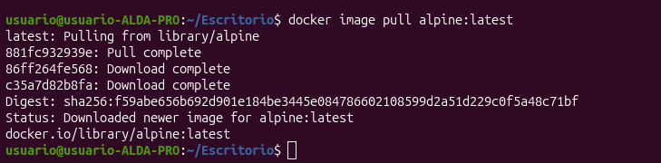
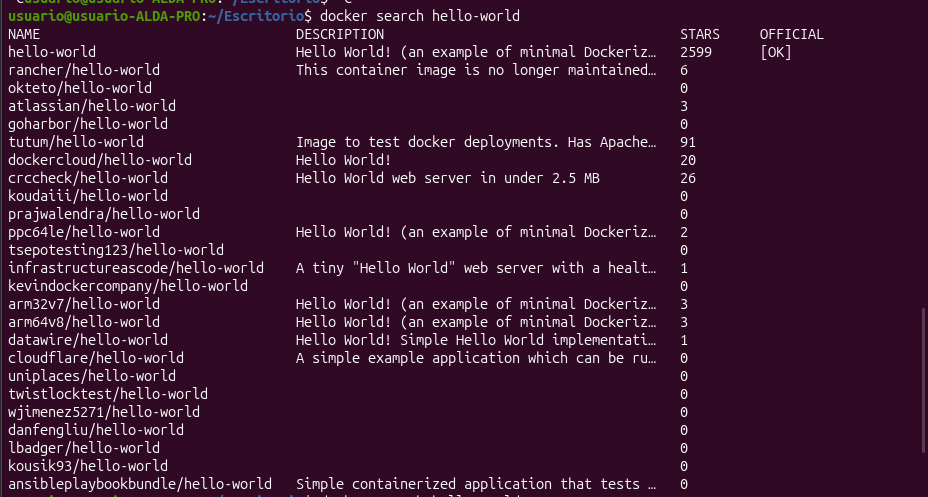
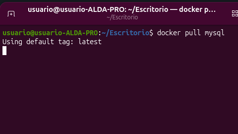

# Docker I

## Ejercicio 1

.png)
---

## Ejercicio 2
### Busca por terminal la imagen de Docker hello-world.

### ¿Cuál de todas las imágenes es la oficial?
.png)
### Haz lo mismo, pero en DockerHub. Marca a la izquierda la casilla Docker Official Image y comprueba que coincide con tu elección del punto anterior.
.png)
### Descarga y ejecuta la imagen elegida en tu ordenador.
.png)
### Haz lo mismo con la imagen hello-seattle.
.png)
### Muestra las imágenes descargadas en tu ordenador.
.png)
### Intenta borrar la imagen hello-seattle ¿Por qué te está dando error?
.png)
### Lista los contenedores de tu ordenador con la opción ls sin parámetros ¿Ves algún contenedor de la imagen hello-seattle?
.png)
### Vuelve a listar los contenedores con la opción ls -a ¿Por qué ahora sí que se muestra el contenedor de la imagen hello-seattle? ¿Para qué sirve la opción -a?
.png)
### Elimina el contenedor que usa hello-seattle y la imagen.
.png)
### Vuelve a listar las imágenes y comprueba que se ha borrado correctamente.
.png)

---

## Ejercicio 3
### Crea una imagen derivada de la imagen hello-world descargada en el ejercicio anterior con docker image tag llamada smr/hola-mundo.

### Borra la imagen original (hello-world).
.png)

### Guarda la nueva imagen creada en el fichero smr-hola-mundo.tar
.png)

### Borra la imagen docker smr/hola-mundo y comprueba que no tienes ninguna imagen.
.png)
.png)

### Añade la imagen smr/hola-mundo mediante docker image load usando el archivo .tar creado anteriormente.
.png)

---

## Ejercicio 4
### Descarga la imagen oficial de mysql.

### Con la imagen que te has descargado, crea un contenedor con nombre mysql_smr y smr como password del usuario root.
.png)

### Ejecuta desde la terminal la orden: docker container exec -it mysql_smr mysql -u root -p
.png)
### Ejecuta la siguiente orden dentro de Mysql para crear una nueva base de datos: CREATE DATABASE prueba;
### Comprueba que se ha creado la bbdd con la orden: show databases;
.png)

---

## Ejercicio 5
### Para el contenedor mysql_smr y vuelve a iniciarlo.
### Para salir de mysql y del contenedor ejecuta la orden exit
### Conéctate de nuevo a Mysql y comprueba que la bbdd prueba sigue estando.
### Elimina el contenedor mysql_smr.
### Vuelve a crearlo con los mismos parámetros y comprueba que la bbdd prueba no existe.
### Sal del contenedor y elimínalo.

---

## Ejercicio 6
### Crea un directorio llamado mysql_data.
### Vuelve a crear el contenedor mysql con los mismos parámetros anteriores pero indicando que la carpeta del contenedor /var/lib/mysql se guardará en el directorio recién creado (mysql_data).
### Crea de nuevo la bbdd pruebas dentro del Mysql del contenedor.
### Sal y elimina el contenedor.
### Crea de nuevo el contenedor sin mapear ninguna carpeta (sin utilizar volúmenes) y comprueba que la bbdd prueba no existe.
### Vuelve a salir y eliminar el contendor.
### Crea de nuevo el contenedor pero mapeando la carpeta igual que antes (la carpeta /var/lib/mysql del contenedor se guardará en mysql_data).
### Comprueba que la bbdd sigue estando en Mysql.

---

## Ejercicio 7
### Crea un directorio llamado php_data.
### Crea un archivo llamado index.php en el directorio recién creado con el siguiente contenido:
´´´ javascript
<?php
phpinfo();
´´´
### Arranca un contenedor con la imagen php:8.0-apache y nombre php_smr indicando que la carpeta del contenedor /var/www/html se guardará en la carpeta creada en el primer punto. Además, el puerto 80 del contenedor se mapeará al puerto 8085 de la máquina real.
### Abre un navegador accede a http://ip_maquina_virtual:8085 y comprueba que se muestra una página similar a ésta:

### Reinicia la máquina virtual.
### Comprueba que accediendo a la anterior url se produce un error.
### Borra el contenedor.
### Vuelve a crear el contenedor pero ahora añade que siempre se reinicie.
### Reinicia la máquina virtual.
### Comprueba que navegando a la anterior url ahora si que funciona.
